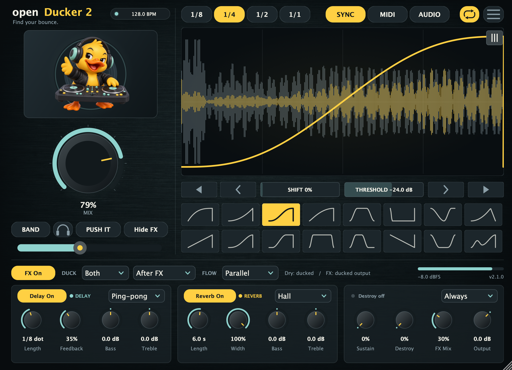
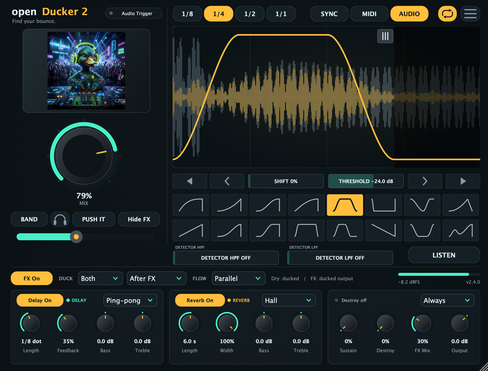

# openDucker 2

**Automatic volume ducking and sidechain effects.** Use openDucker on a bass, pad, lead, or bus to make space around a kick. Choose a trigger, shape one of 16 curves, and add effects that follow the curve.

[Install with OpenVST Manager](https://github.com/alanmarcero/alan-m-OpenVSTManager/releases/latest) · [Download the latest release](https://github.com/alanmarcero/openDucker/releases/latest)

*Native editor capture. [See capture details](docs/SCREENSHOTS.md).*

## Features

- **Triggers:** Sync follows host transport. MIDI starts the curve on each note. Audio starts it when the detector crosses Threshold. Audio uses the sidechain input, or the main input when no sidechain is connected.
- **Curves:** Choose from 16 shapes. Set the cycle to 1/8, 1/4, 1/2, or 1/1. Drag the slope handle to shape recovery. Double-click it to reset. Shift moves the curve against the beat.
- **Retrigger:** Choose whether a new trigger restarts a running curve. When off, new triggers wait until the curve ends.
- **Audio detection:** Set Threshold from −60 to 0 dB. Detector HPF and LPF isolate the trigger range. Listen monitors the filtered detector signal. Set either filter to 0 Hz to bypass it.
- **Low-band ducking:** Turn on BAND to duck frequencies below a selected point from 30 Hz to 1 kHz. Use the headphone control to solo that band.
- **Effects rack:** Turn on FX On to add tempo-synced stereo or ping-pong Delay, Reverb, Sustain, and Destroy.
- **Delay and Reverb:** Delay syncs from 1/32 note to one bar and has feedback and bass/treble shelves. Reverb offers modulated Room, Hall, or Plate types. Set decay from 0.2 to 25 seconds, stereo width, and bass/treble shelves. Set FX Mix and output trim from −24 to +12 dB. The output meter shows peaks.
- **Effects routing:** Choose whether to duck the dry signal, effects, or both. Place ducking before or after the effects. Route Delay and Reverb in series or parallel.
- **Display and menu:** Compare input and output levels across one curve cycle. Hide or show the effects rack while it continues to process audio. Set trigger smoothing to Off, Low, Medium, or High. The menu can reset slope and shift.

Sustain raises quieter parts and controls peaks. Destroy offers Tail and Always modes and adds bitcrush, stutter, and drive. MIDI and Audio triggers can work while playback is stopped.

All controls support host automation and session recall. The plugin supports mono and stereo audio and reports zero latency.

## Install and compatibility

openDucker runs as a DAW plugin. It uses host tempo, MIDI, or sidechain audio. Install it with OpenVST Manager or download a package from the [latest release](https://github.com/alanmarcero/openDucker/releases/latest).

| Platform | Formats |
| --- | --- |
| macOS 11 or later, Intel or Apple Silicon | VST3, AU |
| Windows 10 or later, x64 | VST3 |

Rescan plugins in your DAW after installation. The macOS bundle is not notarized.

## License

openDucker uses the AGPL-3.0 license. See [LICENSE](LICENSE) and [third-party notices](THIRD_PARTY.md). This project is not affiliated with or endorsed by Cableguys. Kickstart, Nicky Romero, and Cableguys are trademarks of their respective owners.
