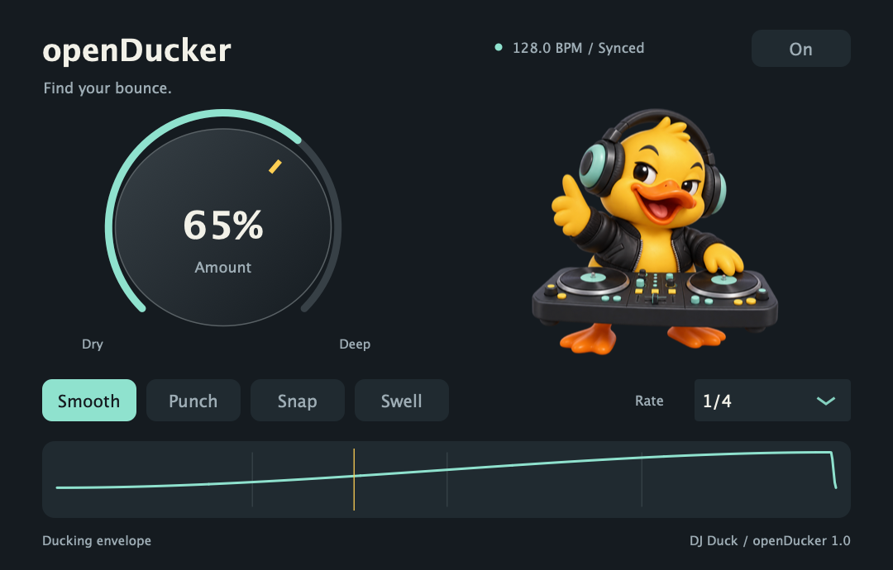

# openDucker


**Find your bounce.** One knob for rhythmic ducking, four recovery slopes, and a clock locked to your host's musical position. No sidechain routing needed.

[Download](https://github.com/alanmarcero/openDucker/releases/latest) · [OpenVST Manager](https://github.com/alanmarcero/alan-m-OpenVSTManager) · [Timing design](docs/superpowers/specs/2026-10-21-open-ducker-design.md)



## Make it bounce

1. Insert openDucker on a sustained synth, bass, pad, or bus and start your DAW's transport.
2. Turn **Amount** up for deeper pumping. 0% is dry; 100% reaches silence at every pulse.
3. Pick **Smooth**, **Punch**, **Snap**, or **Swell** for a different recovery slope.
4. Pick a note length: 1/2, 1/4, 1/8, 1/16, 1/4 triplet, or 1/8 dotted. The default is a quarter note.

Double-click Amount to reset to 65%. Use the **On** button to bypass the entire plugin. All audio controls support host automation and session recall. Mono and stereo, 32-bit and 64-bit audio processing are supported.

The speaker pumps with the selected host-synced rate and idles when playback stops. Smoke and lights rise as Amount increases; animated sparks appear at 70% and above.

## Shape the tail

Turn **FX On** to add the serial chain **Delay → Reverb → Sustain → Destroy**. Effects start disabled, including when opening sessions saved by the original plugin. **FX Mix** blends dry input and the effects output. **Hide FX** collapses the controls without changing the sound.

- **Duck: Dry / Wet / Both** selects which paths follow the Amount envelope. **Before FX** ducks the effects input and lets the tails ring; **After FX** ducks the complete effects output. Position is inactive for Dry-only routing.
- **Delay:** host-synced Length from 1/32 to one bar, Feedback up to 95%, Mono or Ping-pong, and Bass/Treble shelves from −12 to +12 dB. The delay has an eight-second maximum at very slow tempos. Without timing it uses 120 BPM.
- **Reverb:** Room, Hall and Plate use different reflection spacing and diffusion. Length sets an approximate 60 dB decay time from 0.2 to 25 seconds. Width runs from mono to full stereo; Bass and Treble each boost or cut up to 12 dB.
- **Sustain:** a single stereo-linked compression control reduces dynamic range and lifts quiet tails. It extends audible decay without freezing the sound indefinitely.
- **Destroy:** adds distortion, bit crushing, sample holds and short stutters during the final five seconds of the estimated tail, or the entire tail if it is shorter. Delay length, feedback, reverb length and Sustain affect that estimate. Fresh input fades Destroy out and restarts the tail clock. This is phrase-tail processing: sustained input keeps it waiting. Surviving audio continues past the estimate without being cut off.

Delay and Reverb have individual bypass switches. With both stages off, the plugin returns to its original ducking behavior. Both enabled means the delay repeats feed the reverb. EQ and Sustain can raise output peaks; use **Output** and the peak meter to set the final level. Double-click any small knob to restore its default. The four EQ knobs snap to zero while dragging; host automation retains fine adjustments.

## Timing you can inspect

openDucker reads host PPQ and BPM at the start of every audio callback. It calculates the musical position of **each sample** from that anchor. It does not run a UI timer or an accumulating free-running oscillator. This keeps the pulse aligned across buffer sizes, transport restarts, seeks and reported loop boundaries. Audio latency is **zero samples**.

Each slope has a smooth recovery and a short pre-duck ramp before the next beat. Its value and first derivative join at the beat boundary, avoiding a hard waveform cut. Amount, bypass, slope and rate changes blend over 5 ms. After a seek, transport discontinuity, or loop wrap with different envelope phases at its endpoints, a 2 ms amplitude transition suppresses clicks while the phase immediately follows the new host position. The first 2 ms after that jump therefore blend into the new envelope; whole-cycle loops need no transition. Tempo-dependent ramp width changes smooth over 2 ms without smoothing the clock or shifting beat minima.

The ducking gain stays between zero and one. The optional effects and Output trim can increase sample magnitude; the meter turns yellow above 0 dBFS. The plugin does not repair input that is already clipped. Abrupt edits in the source audio remain the host/source's responsibility.

**Host timing is the accuracy boundary.** VST3 and AU expose the position and tempo supplied by the host. If a host changes tempo or seeks *inside* a buffer without reporting that boundary, no plugin using that context can reconstruct the missing timing. Accuracy is sample-level relative to the supplied block position and tempo. Continuous tempo ramps follow the host's callback updates. Ducking ramps to unity when stopped or when valid musical timing is unavailable; it never silently falls back to an unsynced pumping clock. Effects continue processing and tails can ring while stopped. The editor shows the current sync state.

See the [JUCE PositionInfo documentation](https://docs.juce.com/master/classjuce_1_1AudioPlayHead_1_1PositionInfo.html) and [VST3 ProcessContext contract](https://steinbergmedia.github.io/vst3_doc/vstinterfaces/structSteinberg_1_1Vst_1_1ProcessContext.html).

## Install

Use [OpenVST Manager](https://github.com/alanmarcero/alan-m-OpenVSTManager/releases/latest), or extract the release ZIP and copy the bundle into your DAW's plugin folder:

| Platform | Formats | Typical user folder |
| --- | --- | --- |
| macOS 11+, Apple Silicon or Intel | VST3, AU | `~/Library/Audio/Plug-Ins/VST3` or `~/Library/Audio/Plug-Ins/Components` |
| Windows 10+, x64 | VST3 | A VST3 folder configured in your DAW, such as `%LOCALAPPDATA%/Programs/Common/VST3` |

Close your DAW before replacing a plugin and rescan afterward. macOS bundles are ad-hoc signed, not Apple notarized. Verify the release checksum before using macOS's security override for a downloaded bundle. Windows binaries have no publisher certificate. There is no standalone application because host transport is essential to the effect.

## Build and test

CMake 3.22+, a C++20 compiler, and Git are required. CMake fetches JUCE 8.0.9. On macOS, install Xcode command-line tools; on Windows, use Visual Studio 2022 with C++ desktop tools.

```sh
cmake -S . -B build -DCMAKE_BUILD_TYPE=Release
cmake --build build --config Release --parallel
ctest --test-dir build -C Release --output-on-failure
```

On macOS, add `-DCMAKE_OSX_ARCHITECTURES="arm64;x86_64" -DCMAKE_OSX_DEPLOYMENT_TARGET=11.0` for a universal build. Bundles are in `build/openDucker_artefacts/Release/`.

The DSP tests need no third-party dependencies or graphics session:

```sh
cmake -S . -B build-core -DOD_BUILD_PLUGIN=OFF -DCMAKE_BUILD_TYPE=Release
cmake --build build-core
ctest --test-dir build-core --output-on-failure
```

The native test executable exercises actual processor audio, controls and session state, and captures the editor into `build/screenshots/`. The CI also runs address/undefined-behavior sanitizers and pluginval. [Verification record](docs/VERIFICATION.md).

## License and credits

AGPL-3.0; see [LICENSE](LICENSE) and [third-party notices](THIRD_PARTY.md). Original DJ Duck artwork was generated for this project; [prompts](assets/ARTWORK.md) are included. This is an independent implementation inspired by the one-knob rhythmic-pumping workflow. It includes no Waves code, assets or branding and does not claim sonic equivalence to Waves OneKnob Pumper.
