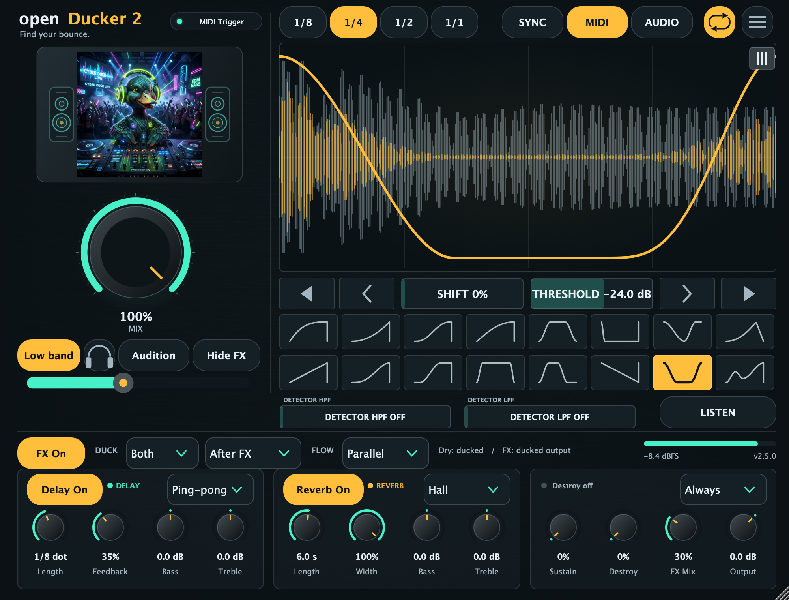

# openDucker 2

**Automatic volume ducking and sidechain effects.** Use openDucker on a bass, pad, lead, or bus to make space around a kick. Choose a trigger, shape one of 16 curves, and add effects that follow the curve.

[Install with OpenVST Manager](https://github.com/alanmarcero/alan-m-OpenVSTManager/releases/latest) · [Download the latest release](https://github.com/alanmarcero/openDucker/releases/latest)

## Beta

All of these plugins are in beta. The macOS and Linux builds are not up to date, so the Windows build is the one to use for now. A plugin can change dramatically from one release to the next, but the goal is for each one to keep getting better.

*Native editor capture. [See capture details](docs/SCREENSHOTS.md).*

## Features

- **Triggers:** Sync follows host transport. MIDI starts the curve on each note. Audio starts it when the detector crosses Threshold. Audio uses the sidechain input, or the main input when no sidechain is connected.
- **Audition** plays a short impact through the curve and effects. The two booth speakers pulse with each host beat in all three trigger modes and hold when playback stops. Without transport data they follow the audio sample clock.
- **Curves:** Choose from 16 shapes. Set the cycle to 1/8, 1/4, 1/2, or 1/1. Set Slope with its bar or drag the slope handle to shape recovery. Double-click the handle to reset it. Shift moves the curve against the beat.
- **Retrigger:** Choose whether a new trigger restarts a running curve. When off, new triggers wait until the curve ends.
- **Audio detection:** Set Threshold from −60 to 0 dB. Detector HPF and LPF isolate the trigger range. Listen monitors the filtered detector signal. Set either filter to Off to bypass it. Off is at the left end of the HPF and the right end of the LPF. In Audio mode, a meter at the right of the curve view shows the detector level against Threshold. The status light flashes on each MIDI or audio trigger.
- **Low-band ducking:** Turn on Low band to duck frequencies below a selected point from 30 Hz to 1 kHz. Use the headphone control to solo that band.
- **Effects rack:** Turn on FX On to add tempo-synced stereo or ping-pong Delay, Reverb, Sustain, and Destroy.
- **Delay and Reverb:** Delay syncs from 1/32 note to one bar and has feedback and bass/treble shelves. Reverb offers modulated Room, Hall, or Plate types. Set decay from 0.2 to 25 seconds, stereo width, and bass/treble shelves. Set FX Mix and output trim from −24 to +12 dB. The output meter shows peaks.
- **Effects routing:** Choose whether to duck the dry signal, effects, or both. Place ducking before or after the effects. Route Delay and Reverb in series or parallel.
- **Display and menu:** The curve view draws the incoming audio behind the duck curve and keeps it locked to the host cycle. A connected sidechain is shown there; otherwise the main input is shown. Output level stays on the same grid. Hide or show the effects rack while it continues to process audio. Smoothing softens every duck: Off, Low, Medium, or High. The menu can reset slope and shift.
- **Presets:** Sixteen factory patches are in the DAW program list and the preset browser. Factory patches stay read-only. Save, rename, and delete your own presets in Documents/Alan Marcero/openDucker/Presets. Search the list and mark favorites. The arrows beside the preset name step through the list, and an asterisk marks unsaved edits.
- **Undo and compare:** Undo and redo parameter edits with the buttons, or with Cmd/Ctrl+Z and Shift+Cmd/Ctrl+Z. Slots A and B each hold a full patch. Copy either slot into the other.

Sustain raises quieter parts and controls peaks. Destroy offers Tail and Always modes and adds bitcrush, stutter, and drive. MIDI and Audio triggers can work while playback is stopped.

Drag a bar to change it, click it to type a value, or Alt-click it to reset it. All controls support host automation and session recall. The plugin supports mono and stereo audio. Lookahead delays the audio by up to 5 ms so each duck reaches its floor before the transient, and the plugin reports that delay to the host as latency. With Lookahead off, it adds no latency.

## Install and compatibility

openDucker runs as a DAW plugin. It uses host tempo, MIDI, or sidechain audio. Install it with OpenVST Manager or download a package from the [latest release](https://github.com/alanmarcero/openDucker/releases/latest).

| Platform | Formats |
| --- | --- |
| macOS 11 or later, Intel or Apple Silicon | VST3, AU |
| Windows 10 or later, x64 | VST3 |

Rescan plugins in your DAW after installation. The macOS bundle is not notarized.

## License

openDucker is released under the MIT license. See [LICENSE](LICENSE). Third-party components, including JUCE, keep their own licenses; see [third-party notices](THIRD_PARTY.md). This project is not affiliated with or endorsed by Cableguys. Kickstart, Nicky Romero, and Cableguys are trademarks of their respective owners.
