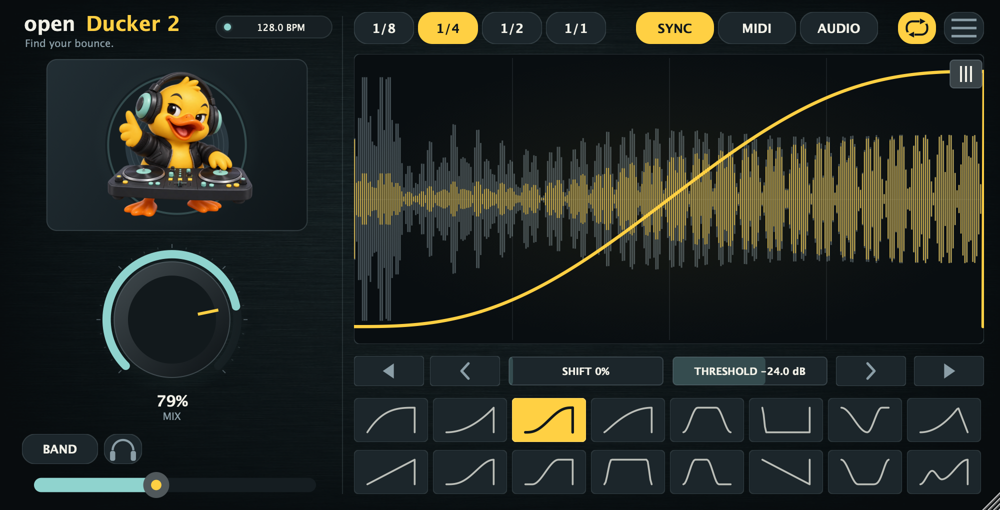
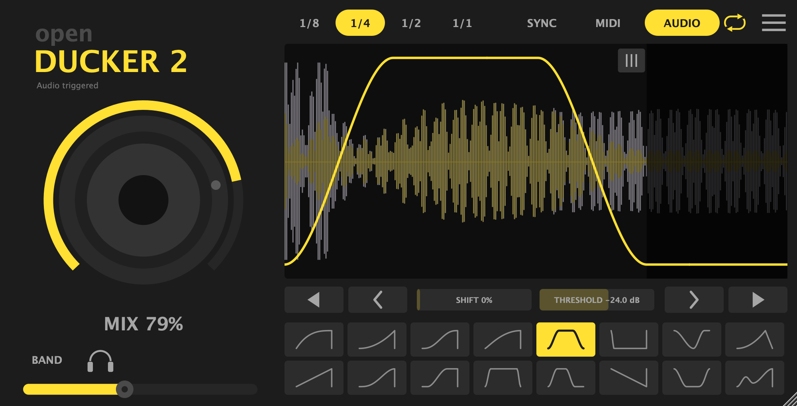
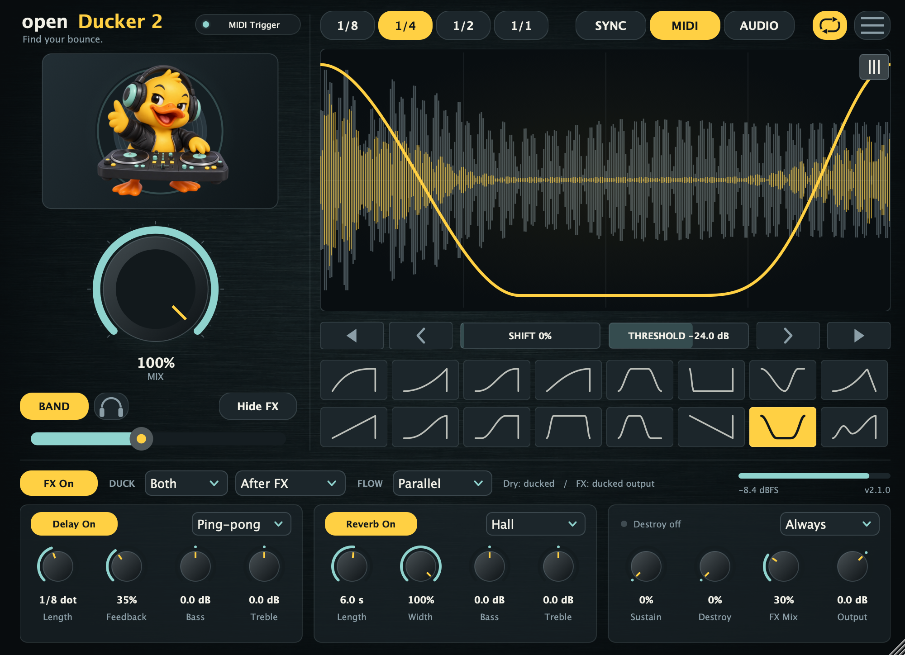

# openDucker 2

[Install with OpenVST Manager](https://github.com/alanmarcero/alan-m-OpenVSTManager/releases/latest)

**Fast, sample-accurate volume ducking without sidechain routing.** Drop it on a bass, pad or bus, pick one of 16 curves, drag the slope to fit your kick, and trigger it from the host tempo, MIDI notes or incoming audio.

[Download](https://github.com/alanmarcero/openDucker/releases/latest) · [OpenVST Manager](https://github.com/alanmarcero/alan-m-OpenVSTManager) · [Verification](docs/VERIFICATION.md)



*Captured from the running v2.0.0 native editor. [Capture details](docs/SCREENSHOTS.md).*

## What's in v2

openDucker 2 is a ground-up redesign into a single-purpose kick-and-bass ducker, modelled on the workflow of a popular commercial plugin (see [License and credits](#license-and-credits)). The v1 effects section, mascot and Amount knob are gone.

| Control | What it does |
| --- | --- |
| **Length 1/8 · 1/4 · 1/2 · 1/1** | Cycle length, synced to the host tempo. |
| **SYNC / MIDI / AUDIO** | **Sync** loops the curve with the host transport. **MIDI** restarts it on every note-on, to the sample. **Audio** restarts it when the sidechain input (or the main input if no sidechain is connected) crosses **Threshold**. |
| **Mix** | Blend between the original and the ducked signal (default 100%). |
| **16 curves** | Click one of the 16 curve buttons, or use the arrows: chevrons step one curve, triangles jump a row of eight. |
| **Slope handle** | Drag the handle in the display to shorten or stretch the curve inside the cycle (5–100%). Double-click it to reset. |
| **Shift** | Moves the curve against the beat. In MIDI and Audio modes it delays the curve after each trigger. |
| **Threshold** | Audio trigger level, −60 to 0 dB. |
| **Retrigger** (loop icon) | When on, a new trigger restarts a running curve; when off, triggers are ignored until it finishes. |
| **BAND, band slider, headphones** | Duck only the low band below the band frequency (30 Hz–1 kHz) with a Linkwitz-Riley 4th-order split; the headphones solo that band. |
| **Menu** | Trigger smoothing (Off, Low, Medium, High), reset slope and shift, About. |

The display overlays the input (grey) and output (yellow) over one cycle, so you can line the curve up with a kick and bass by eye. The editor resizes freely at a fixed aspect ratio.





## Using it

1. Insert openDucker on the sound you want to duck (bass, pad, bus).
2. **Sync:** start the transport and choose a Length. **MIDI:** route a kick or drum track's MIDI to the plugin. **Audio:** enable the plugin's sidechain input in your DAW and send the kick to it, or leave it disconnected to trigger from the plugin's own input.
3. Pick a curve, then drag the slope handle until the recovery fits your kick.
4. Turn on **BAND** to keep the mids and highs untouched, and use the headphones to hear only the ducked band.

All controls support host automation and session recall. Mono and stereo, 32-bit and 64-bit processing are supported. Latency is zero samples. Ducking in Sync mode ramps to unity when the host is stopped or provides no musical timing; it never free-runs. MIDI and Audio modes work while stopped, using the host tempo (120 BPM if none is available).

> **Upgrading from v1:** v2 is a different plugin design with new parameters. v1 sessions load but their old settings are not carried over.

## Timing you can inspect

In Sync mode, openDucker reads the host PPQ and BPM at the start of each audio block and computes the musical position of **each sample** from that anchor. No UI timer or free-running oscillator is involved, so the curve stays aligned across buffer sizes, seeks, loops and tempo changes. MIDI notes are applied at their exact sample offsets. Audio triggers fire on the sample that crosses the threshold, with a 30 ms hold-off and re-arm once the level falls below half the threshold. Host timing is the accuracy boundary: a host that changes tempo or seeks inside a buffer without reporting it cannot be followed by any plugin.

## Install

1. Download and install [OpenVST Manager](https://github.com/alanmarcero/alan-m-OpenVSTManager/releases/latest) for macOS or Windows.
2. Open the manager and refresh the catalog.
3. Choose **openDucker**, select **VST3** (or **AU** on macOS), and install.
4. Rescan plugins in your DAW. If you chose a custom install folder, add it to the DAW's search paths.

For manual installation, extract your platform ZIP from the [latest release](https://github.com/alanmarcero/openDucker/releases/latest) and copy the entire bundle into your DAW's plugin folder:

| Platform | Formats | Typical user folder |
| --- | --- | --- |
| macOS 11+, Apple Silicon or Intel | VST3, AU | `~/Library/Audio/Plug-Ins/VST3` or `~/Library/Audio/Plug-Ins/Components` |
| Windows 10+, x64 | VST3 | A VST3 folder configured in your DAW, such as `%LOCALAPPDATA%/Programs/Common/VST3` |

Close your DAW before replacing a plugin and rescan afterward. macOS bundles are ad-hoc signed, not Apple notarized. Verify the release checksum before using macOS's security override for a downloaded bundle. Windows binaries have no publisher certificate. There is no standalone application because host transport, MIDI and sidechain audio are essential to the effect.

## Build and test

CMake 3.22+, a C++20 compiler, and Git are required. CMake fetches JUCE 8.0.9. On macOS, install Xcode command-line tools; on Windows, use Visual Studio 2022 with C++ desktop tools.

```sh
cmake -S . -B build -DCMAKE_BUILD_TYPE=Release
cmake --build build --config Release --parallel
ctest --test-dir build -C Release --output-on-failure
```

On macOS, add `-DCMAKE_OSX_ARCHITECTURES="arm64;x86_64" -DCMAKE_OSX_DEPLOYMENT_TARGET=11.0` for a universal build. Bundles are in `build/openDucker_artefacts/Release/`.

The DSP tests need no third-party dependencies or graphics session:

```sh
cmake -S . -B build-core -DOD_BUILD_PLUGIN=OFF -DCMAKE_BUILD_TYPE=Release
cmake --build build-core
ctest --test-dir build-core --output-on-failure
```

The native test exercises real processor audio, every editor control and session state, and captures the editor into `build/screenshots/`. CI also runs address/undefined-behavior sanitizers and pluginval. [Verification record](docs/VERIFICATION.md).

## License and credits

AGPL-3.0; see [LICENSE](LICENSE) and [third-party notices](THIRD_PARTY.md). openDucker is an independent implementation inspired by the workflow and layout of Nicky Romero's Kickstart 2 by Cableguys. It contains no Kickstart or Cableguys code, artwork, curve data or branding, is not affiliated with or endorsed by them, and does not claim sonic equivalence. "Kickstart", "Nicky Romero" and "Cableguys" are trademarks of their respective owners.
