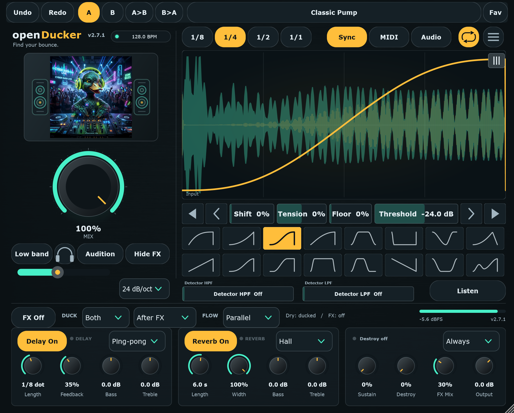
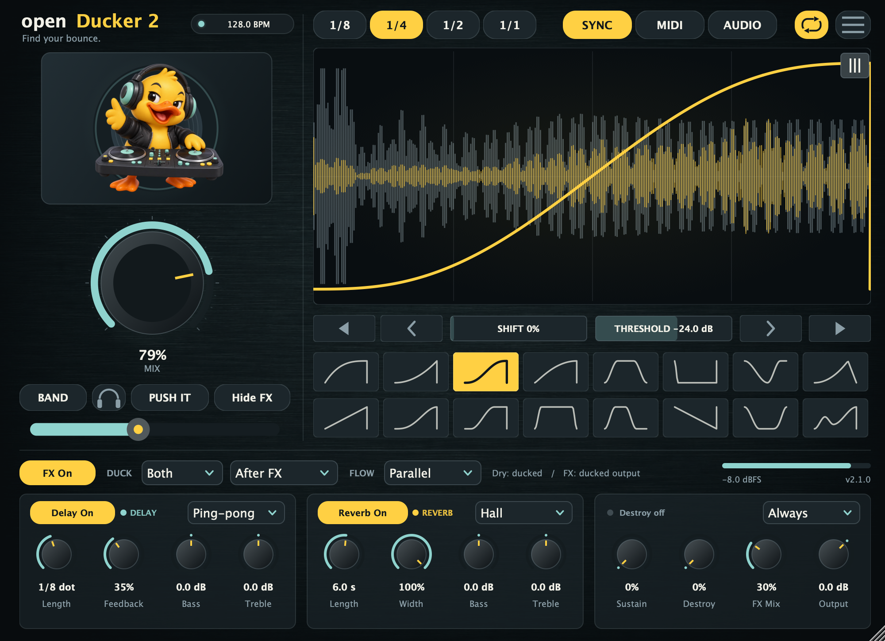

# openDucker 2.7.0

Draws the sidechain, or the main input when no sidechain is connected, behind the duck curve and locks that waveform to the host cycle. Adds 16 factory patches to the DAW program list and the preset browser, plus undo/redo, A/B compare, and user presets saved under Documents/Alan Marcero/openDucker/Presets. The project license is now MIT. JUCE keeps its own license.

# openDucker 2.6.1

Skips running inactive reverb and filter stages and optimizes ducking curve math for lower CPU usage.

# openDucker 2.6.0

Adds Curve Tension Skew, Ducking Floor, Selectable Crossover Slope, and UI uniformity updates.

# openDucker 2.5.0

The two speakers in the DJ booth pulse on host quarter notes in Sync, MIDI and Audio modes. Audition plays an impact through the selected curve and effects. Larger controls, clearer labels and accessible names make the trigger settings and low-band controls easier to operate.

Install the Windows x64 VST3 package, or update through OpenVST Manager. Close your DAW before replacing the plug-in and rescan afterward. SHA256SUMS.txt verifies release checksums.
