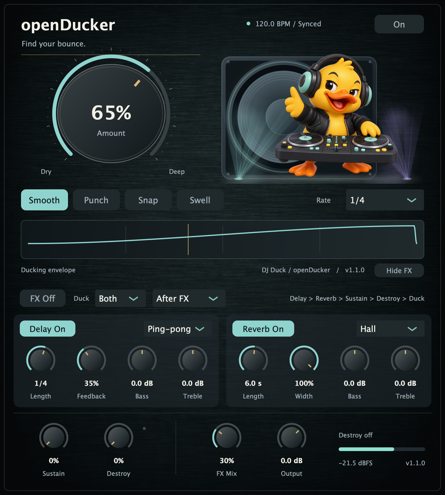

# Native UI screenshot

`assets/native-ui.png` was captured on macOS on 2026-10-27 from the actual **v1.1.0 VST3 editor**, loaded in a JUCE 8.0.9 host. It shows the plugin's default state while processing a stereo test signal at 48 kHz with a 120 BPM host transport. The host renders the native AppKit view into a PNG at the display's backing resolution (1440 × 1600). Controls, labels, meters and version text come from the running plugin.

- [Release v1.1.0](https://github.com/alanmarcero/openDucker/releases/tag/v1.1.0)
- Source commit: [`b811bea`](https://github.com/alanmarcero/openDucker/commit/b811bead57080ac066840f50ea5358f5c0d04c97)
- Release asset: `openDucker-macOS-universal.zip`
- Archive SHA-256, verified before capture: `c49a31f6b8fb7a256968b1e8f88b0dc899a2b93fe4cac6a88fdd210fdd56e0d5`
- Screenshot SHA-256: `10d64055c1eef1a4613d2718be6548166632f952f58f528ed3ba5a2abc3c44a5`
